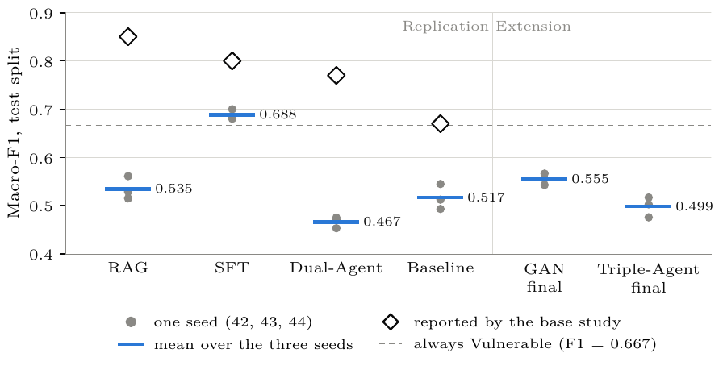

# vulndetect — LLM-based vulnerability detection in C/C++

[](https://github.com/EliasDevv/vulndetect/actions/workflows/ci.yml)

[](LICENSE)

Replication and extension of *"An Empirical Evaluation of LLM-Based Approaches for Code
Vulnerability Detection: RAG, SFT, and Dual-Agent Systems"* (Saju et al., 2026,
[arXiv:2601.00254](https://arxiv.org/abs/2601.00254)) on the public
[Big-Vul](https://github.com/ZeoVan/MSR_20_Code_vulnerability_CSV_Dataset) dataset.
Written as part of my Bachelor's thesis at Leipzig University.

**In short:** on one shared dataset, one parser and one evaluation harness, QLoRA fine-tuning
is the only one of six approaches that clearly beats the baseline (F1 0.69 vs. 0.52). RAG, the
Dual-Agent and the GAN-style strategy loops stay close to it or fall below it, and none of the
absolute numbers reaches those reported by the base study.

Six approaches share one dataset, one output parser and one evaluation harness, and all run
on `meta-llama/Llama-3.2-3B-Instruct` (pinned revision, Hugging Face transformers):

| Approach     | Module                    | Idea                                                                 |
|--------------|---------------------------|----------------------------------------------------------------------|
| Baseline     | `vulndetect.baseline`     | Direct prompting with the paper's prompt                             |
| RAG          | `vulndetect.rag`          | Adds retrieved MITRE CWE catalogue chunks (Chroma index + re-ranker) |
| SFT          | `vulndetect.sft`          | QLoRA fine-tuning on the training split                              |
| Dual-Agent   | `vulndetect.dual_agent`   | Detector answer checked by a Validator                               |
| GAN          | `vulndetect.gan`          | LLM-GAN strategy loop after Wang et al. (ICASSP 2025)                |
| Triple-Agent | `vulndetect.triple_agent` | GAN loop with the Dual-Agent as the detecting party                  |

## Results

Test split (986 functions, five CWE classes: 119, 20, 200, 264, 399), macro average over
three seeds (42–44), mean ± std:

| Approach             | Accuracy      | Precision     | Recall        | F1            |
|----------------------|---------------|---------------|---------------|---------------|
| Baseline             | 0.576 ± 0.020 | 0.617 ± 0.025 | 0.455 ± 0.026 | 0.517 ± 0.026 |
| RAG                  | 0.576 ± 0.019 | 0.604 ± 0.025 | 0.491 ± 0.021 | 0.535 ± 0.024 |
| SFT (QLoRA)          | 0.657 ± 0.015 | 0.636 ± 0.022 | 0.761 ± 0.038 | 0.688 ± 0.010 |
| Dual-Agent           | 0.521 ± 0.011 | 0.526 ± 0.014 | 0.421 ± 0.010 | 0.467 ± 0.012 |
| GAN (final)          | 0.595 ± 0.008 | 0.632 ± 0.014 | 0.512 ± 0.021 | 0.555 ± 0.012 |
| Triple-Agent (final) | 0.549 ± 0.014 | 0.563 ± 0.015 | 0.451 ± 0.024 | 0.499 ± 0.021 |



Each dot is one seed, the bar the mean over seeds, the diamond the value reported by the base
study, the dashed line the F1 of always answering *Vulnerable*.

Fine-tuning gives by far the largest gain in this setup; the prompting-based variants stay
close to the baseline. Per-CWE numbers, paired t-tests and McNemar tests (Holm-corrected)
are in [`results/metrics/comparison_test.md`](results/metrics/comparison_test.md).
Absolute numbers are not comparable to the original paper, which used partly proprietary
data.

## Limitations

- One small open model (`Llama-3.2-3B-Instruct`, fp16) and one dataset (Big-Vul, five CWE
  classes, function-level C/C++); results need not transfer to larger models or other data.
- Three seeds per approach; the statistics (paired t-tests, McNemar with Holm correction)
  are in `results/metrics/comparison_test.md`.
- The base study used partly proprietary data and left several prompt and decoding details
  open, so absolute numbers are not comparable.
- SFT adapters are not included (size); the GPU runs took place on a shared server.

## Quickstart (CPU, no GPU)

Re-derive the comparison tables and statistics from the committed predictions:

```bash
uv sync --extra dev
make eval          # results/metrics/comparison_test.{md,json}
```

New model runs need a GPU and the setup below.

## Requirements

- Python 3.12 and [uv](https://docs.astral.sh/uv/)
- A CUDA GPU for all model runs (fp16 inference; SFT training additionally needs the
  `train` extra with bitsandbytes)
- Access to the gated model `meta-llama/Llama-3.2-3B-Instruct` and a Hugging Face token

Tests, aggregation and the figures run on CPU without a GPU.

## Setup

```bash
uv sync --extra dev            # or: make setup   (add --extra train for SFT training)
cp .env.example .env           # then set HF_TOKEN
uv run pytest                  # or: make test
```

Without the `train` extra, two SFT tests that need `peft`/`trl` are skipped.

## Data

The repository ships the frozen split reference (`data/reference/bigvul_splits_v1.json`) and the
dataset/index manifests with their SHA256 hashes, but not the Big-Vul splits or the Chroma index
themselves: the splits contain third-party commit metadata and the raw downloads are about 12 GB.
Both are rebuilt deterministically from the public sources (train 5000 / val 500 / test 986):

```bash
BIGVUL_GDRIVE_ID=1-0VhnHBp9IGh90s2wCNjeCMuy70HPl8X make data   # Big-Vul -> splits
make cwe-index                                                 # CWE catalogue -> index
```

Sources, snapshot hashes and the split procedure: [`data/README.md`](data/README.md).

## Running the experiments

Every run reads one YAML file from `configs/` and writes to
`results/predictions/<experiment>/seed<N>/` (`manifest.json` with config hash, model
revision and prompt version, `predictions.jsonl`, `metrics.json`). Each approach has three
stages:

| Stage | Target (example)  | Data                       | Logged to `results/experiments.csv` |
|-------|-------------------|----------------------------|-------------------------------------|
| smoke | `make rag-smoke`  | 10 val instances           | no                                  |
| val   | `make rag-val`    | full val split             | no                                  |
| test  | `make rag`        | full test split, seed 42   | yes                                 |

Seeds 43 and 44: `make baseline-seed43`, `make rag-seed44`, and so on. `make help` lists
all targets, including ablation and control runs.

- **SFT:** `make sft-train` trains the QLoRA adapter into `models/sft/seed<N>/`, then
  `make sft` evaluates it. Adapters are not included (size).
- **GAN / Triple-Agent:** `make gan-val` / `make triple_agent-val` run the strategy loop on
  the training split and evaluate its snapshots on val; `make gan-eval` /
  `make triple_agent-eval` evaluate them on test.

## Reproducing the reported results

All runs behind the numbers above are included in `results/` (see
[`results/README.md`](results/README.md)). Comparison, tables and figures can be
regenerated on CPU:

```bash
make eval       # results/metrics/comparison_test.{md,json}
make eval-val   # results/metrics/comparison_val.{md,json}
make tables     # diagnostics, result tables and figures (results/figures/)
```

`make eval` computes mean ± std over seeds, paired t-tests and McNemar tests with Holm
correction. The token counts in the diagnostics load the Llama tokenizer (needs the HF
token; skip with `uv run python scripts/ch7_diagnostics.py --no-tokenizer`). `make eval` and
`make tables` also write LaTeX table fragments (`*.tex`) into `results/metrics/`; these
are not versioned here.

## Project layout

```
configs/      one YAML per run (seed, model revision, decoding, paths)
data/         frozen split reference and manifests (splits/index are rebuilt, see Data)
experiments/  label_definition/: separate val-only ablation with its own README
results/      predictions, loop outputs, metrics, figures
scripts/      data download, tables/figures/diagnostics, post-hoc analyses
src/vulndetect/
  common/     model loading, prompts, output parser, config handling
  data/       Big-Vul loading, filtering, balancing, commit-level splits
  eval/       metrics, statistical tests, aggregation, experiment log
  baseline/ rag/ sft/ dual_agent/ gan/ triple_agent/   one package per approach
tests/        unit and configuration tests
```

`scripts/gpu_queue.sh`, `gpu_wait_run.sh` and `fetch_results.sh` are helpers for the shared
GPU server the experiments ran on; they are not needed elsewhere.

## Citation

If you use this code, please cite it via [`CITATION.cff`](CITATION.cff) (GitHub: *Cite this repository*).

## Licenses and attribution

- **Code:** [MIT](LICENSE).
- **Big-Vul:** MIT, Copyright (c) 2020 ZeoVan. Please cite Fan, Li, Wang and Nguyen, *A C/C++
  Code Vulnerability Dataset with Code Changes and CVE Summaries*, MSR 2020. The dataset is not
  included; the prediction files quote short code excerpts and commit messages from it
  (including the e-mail addresses that appear in them).
- **MITRE CWE:** Copyright © 2006–2026 The MITRE Corporation. CWE is a trademark of The MITRE
  Corporation; used under the [CWE terms of use](https://cwe.mitre.org/about/termsofuse.html).
- **Llama:** Built with Llama. Llama 3.2 is licensed under the Llama 3.2 Community License,
  Copyright © Meta Platforms, Inc. All Rights Reserved. No model weights or adapters are
  included.
- **Prompts of the base study:** the prompt templates of Saju et al. are reproduced verbatim
  in `src/vulndetect/*/prompt.py` and `tests/fixtures/authors_*.txt` to replicate their setup.
